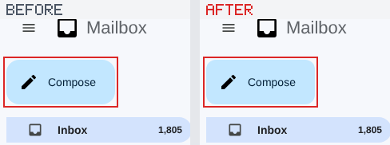
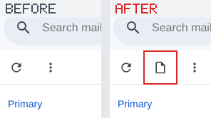

# uihash

**Visual regression checks for pull requests that compare what the UI is asked to look like, not
its pixels.**

uihash renders your base branch and your PR in Chromium and compares every element's computed CSS,
text, structure and accessibility tree. It learns from several renders of the base which parts of a
page are data (rows, names, counts, dates), so different data does not raise an alarm. A 1px padding,
a near-identical colour or a lost focus ring does. Every change lands in one PR comment, boxed in
red on before/after crops, named down to the CSS property, and labelled with how likely it is to be
unintended.

| `nav.side › button.compose` — `border-radius: 16px → 12px` | `div.toolbar` — `added child button.icon-btn` |
|---|---|
|  |  |

> **Status:** research prototype (0.1). It has been tested on synthetic apps with known ground truth
> and on live websites. The numbers are in [RESEARCH.md](RESEARCH.md).

## Contents

- [Why not screenshot diffs?](#why-not-screenshot-diffs)
- [What a PR gets](#what-a-pr-gets)
- [Quick start](#quick-start)
- [Preparing your app](#preparing-your-app)
- [Configuration](#configuration)
- [GitHub Actions](#github-actions)
- [Reading the comment](#reading-the-comment)
- [Approving changes](#approving-changes)
- [Command line](#command-line)
- [What it catches, and what it doesn't](#what-it-catches-and-what-it-doesnt)
- [How it works](#how-it-works)
- [Project layout](#project-layout)

## Why not screenshot diffs?

Screenshot comparison has three problems:

- **Data looks like a regression.** A new row, another timestamp or a different avatar changes pixels,
  so every run flags something. Teams respond by raising thresholds and masking regions.
- **Raised thresholds let real regressions through.** Playwright's default comparison passes 21 of
  the 66 subtle changes in this repo's test suite that do change pixels, among them a hover
  background at ΔE00 5.9 ("clearly visible"), two changes that fail WCAG AA contrast and a redrawn
  canvas sparkline.
- **A failed diff names no cause.** It says which pixels changed, not that a wider `gap` in the
  toolbar pushed a button out of the window.

uihash compares the CSS values the browser computed for each element (`auto`, `50%`, `1fr`), the
text, the element structure and what a screen reader announces. It learns which of those vary with
data, so a new email in an inbox passes and `font-weight: 700 → 600` on unread rows fails.

## What a PR gets

- **One comment, updated on every push.** It shows the verdict, the counts per label, a list of what
  to look at first, and, for each page state that changed, numbered findings with before/after crops.
- **Red boxes** on the elements that changed. **Dashed outlines** mark content that only moved
  because of them, such as a list pushed left by a wider sidebar.
- **Explanations** such as these:
  - `border-radius: 16px → 12px`
  - `text: "Compose" → "Compse"`
  - `contrast below WCAG AA: 4.54:1 → 4.48:1`
  - `div.toast[status] now under polyline`
  - `top edges of div.label and div.label (3) no longer line up (1px apart)`
- **A label on every finding** for how likely it is to be unintended, and **the edit that caused it**:
  `From rule .compose: border-radius: 16px → 12px`, or `Not from a CSS change: the markup, a script
  or the data changed`.
- **A failing check** until someone approves exactly this set of changes with a label.
- **A full report**: `report.html` with full-page screenshots, `summary.json` for tooling, and the
  crops as PNGs.

## Quick start

You need Node.js 18 or later; the CI template uses 22. uihash drives Chromium through Playwright.

```bash
git clone https://github.com/jacobs0925/uihash && cd uihash
npm install
npx playwright install chromium

# a demo PR: two small apps, five deliberate UI changes and one no-op refactor
npm run demo:pr
open /tmp/uihash-demo/report/report.html      # (xdg-open on Linux); comment.md is the PR comment
```

uihash reports exactly the five changes and ignores the refactor. To check your own app, serve the
base build and the PR build on two ports and point uihash at them:

```bash
node bin/uihash.js pr --base http://localhost:4001/ --head http://localhost:4002/ \
  --config uihash.config.json --out uihash-report
```

The exit code is `0` when nothing changed (or only warnings), `1` when the UI changed or a page
state failed to render in the PR, and `2` when the check could not run, for example because of bad
arguments or an unreadable config.

## Preparing your app

uihash needs two things from the app under test.

**1. Fixture data chosen by a seed in the URL.** On the base build, uihash renders every page with
`seed=1` to `seed=6` and learns what differs between them: those parts are data. The PR build is
rendered with `seed=1`, the same data as the base reference render, so the two can also be compared
element by element. Use whatever your app already has: a mock API, MSW handlers or a fixtures mode.

```json
{ "name": "Inbox", "path": "inbox?seed={i}" }
```

If you cannot vary the data, set `"quick": true`. Every page is then compared on one fixture with no
calibration. That is stricter, so a PR that changes the fixture data itself shows up as a change.

**2. Determinism for the same data.** uihash pins what it can:
- the clock is frozen;
- `Math.random` is seeded;
- animations and transitions are stopped;
- the caret is hidden;
- each page waits for the network to go quiet and for two consecutive snapshots to agree.

Anything else that differs between two renders of the same fixture causes false alarms. Common
culprits are server timestamps, random IDs from a backend, and A/B assignment. The CI `baseline` job
renders `main` against itself to find these.

## Configuration

`uihash.config.json` lives in your app's repo:

```json
{
  "runs": 6,
  "viewports": [
    { "name": "desktop", "width": 1280, "height": 800 },
    { "name": "phone", "width": 390, "height": 844, "deviceScaleFactor": 3, "isMobile": true, "hasTouch": true }
  ],
  "pseudoStates": ["hover", "focus"],
  "media": [{ "name": "dark", "colorScheme": "dark" }, { "name": "print", "media": "print" }],
  "pages": [
    {
      "name": "Inbox",
      "path": "inbox?seed={i}",
      "states": {
        "settings menu": "[aria-label=\"Settings\"]",
        "compose": ["nav button.compose"],
        "search results": [{ "fill": ".search", "value": "invoice" }, ".search-go"],
        "row menu + hover": ["right:.row:first-child", "@hover"]
      }
    },
    { "name": "Dashboard", "path": "dashboard?seed={i}", "viewports": ["desktop"] }
  ]
}
```

Every page is checked as loaded and in each named state, at each viewport. Each page as loaded is
also rendered with `:hover` and `:focus` forced (every hover or focus style on at once, which a static
render never shows) and under each emulated medium.

**States** are lists of actions, run in order after the page loads:

| action | does |
|---|---|
| `".selector"` | click it |
| `"hover:.selector"` | move the mouse over it (JavaScript hover handlers run) |
| `"right:.selector"` | right-click it (context menus) |
| `{ "fill": ".selector", "value": "text" }` | type into a field |
| `"@hover"`, `"@focus"`, `"@active"`, `"@disabled"`, … | force that pseudo-class once the rest is done |

**Options**, top level unless noted. Some can also be set per page.

| option | default | what it does |
|---|---|---|
| `pages` | (required) | `name`, `path` with `{i}`, and optional `states`, `viewports` (names), `pseudoStates`, `media`, `variants`, `explore` |
| `runs` | `6` | base renders per state used to learn what is data |
| `viewport` / `viewports` | 1280×800 | one size, or named sizes; a viewport may emulate a device |
| `pseudoStates` | `["hover", "focus"]` | forced pseudo-class renders; any class Chromium can force (`active`, `disabled`, `checked`, `user-invalid`, …) |
| `media` | `[]` | emulated media: `colorScheme`, `media` (`print`), `reducedMotion`, `forcedColors` |
| `variants` | `[]` | quick checks on one fixture: another `width`, longer text (`textScale: 1.4`, as translations make it), or WCAG text spacing (`textSpacing: true`) |
| `mediaWidths` | `true` | also check the widths that the PR's changed media queries apply to |
| `explore` | `false` | `true` (up to 24 controls) or a number: also click each control of the page as loaded, compare the page after each click, and report controls that stopped doing anything |
| `a11y` | `true` | compare the accessibility tree (names, roles, states) |
| `palette` | `true` | report categorical colours that became hard to tell apart, including for colour-blind users |
| `coverage` | `false` | warn about CSS rules the PR changed that no checked state uses |
| `attribute` | `true` | trace each finding to the CSS edit that causes it (see [below](#reading-the-comment)) |
| `quick` | `false` | compare every state on one fixture only, with no calibration |
| `keys` | `"class"` | how elements are named: by classes, or `"tag"` if class names change between builds |
| `concurrency` | `4` | browser pages rendered in parallel |
| `freezeTime`, `seedRandom` | `2026-01-15T12:00:00Z`, `42` | the frozen clock and the `Math.random` seed |
| `networkIdleMs` | `150` | how long the network must be quiet before capture |
| `maxElements` | `50000` | a state with more elements fails to render instead of being extracted (each element's styles are kept, so a page of hundreds of thousands takes gigabytes); `0` for no limit |
| `offline` | `false` | requests and WebSockets to any host but the local one fail, and service workers are off: for apps that call live backends, analytics or web fonts, so both builds render the same way and no outside server is contacted |
| `renderTimeoutMs` | `120000` | a render not finished by then (a page that never settles) fails, and its browser page is closed; `0` for no limit |
| `confirm` | `true` | a state that shows a change is compared a second time, a new head render against the base's second render, and only what both comparisons show is reported: rendering that depends on timing (a forced hover applied before the element mounted, a layout shift caught or not) is not a change. Costs one render per changed state; `false` turns it off |
| `imageBaseUrl` | (none) | where the comment's images are served from (`{file}` is replaced) |
| `model` | (none) | a learned triage model (`learn/model.json`), relative to the config: an advisory score per finding (see [below](#learned-triage-advisory)) |
| `feedback` | `false` | ask the reviewer, per finding, whether it was intended (tick boxes in the comment); the answers train the model |

## GitHub Actions

Copy [`ci/github/uihash.yml`](ci/github/uihash.yml) to `.github/workflows/uihash.yml` in your app's
repo. Put this folder in the repo too, vendored or as a submodule. Then fill in the `env` block:

```yaml
env:
  UIHASH: tools/uihash                  # where this folder lives in your repo
  CONFIG: uihash.config.json
  INSTALL: npm ci
  BUILD: npm run build
  SERVE: npx --yes http-server@14 dist -s -p $PORT    # must serve the built app on $PORT
  PUBLISH_IMAGES: 'true'                # push comment crops to a `uihash-assets` branch
```

On every push to a PR, the `pr` job does the following:
1. Checks out the base commit and the PR, builds both, and serves them on ports 4001 and 4002.
2. Runs `uihash pr`, uploads the full report as the `uihash-report` artifact, and posts or updates
   one comment.
3. Fails the check when the UI changed, until the change is approved (below).

On every push to `main`, a `baseline` job renders the new commit and caches its calibration. PRs
based on that commit then render only their own build. On 4 CPUs the demo above takes about 17
seconds the first time and about 7 seconds with the base cached. The same job renders `main` against
itself, so nondeterminism in the app shows up there before it causes false alarms on PRs.

Comment images are pushed to a `uihash-assets` branch and linked so that signed-in readers of private
repos can see them. PRs from forks get a read-only token: they still get the report artifact and the
job summary, but no comment.

## Reading the comment

Every finding carries a label. Labels are a reading aid: they put the findings that need a closer
look first, and they never approve anything on their own.

| label | meaning | examples |
|---|---|---|
| 🚫 **breaks** | the UI lost something it should keep whatever the design | content now cut off, covered or pushed out of a window that does not scroll; text contrast below WCAG AA; a focus ring gone; invisible but still clickable; an image broken, blurry or cropped; a highlight no longer over its label; things that looked different now looking the same; an "on" state that looks like "off"; hover feedback gone |
| ⚠️ **check** | likely unintended | a button, item or accessible name removed; text newly truncated; one instance of a component drifting from the others; toolbar buttons no longer the same height; numbers that changed on the same data; duplicated list items; a CSS edit reaching an element its rule does not select, or winning only through `!important` |
| 🎨 **token** | from a redefined design token | `--accent` changed in `:root`, so every element that uses it changed |
| ✏️ **yours** | from your CSS edit on that element | `.compose { border-radius }` changed and the compose button changed |
| ▫️ **other** | from a markup, script or data change, and nothing was lost | a renamed label, a new button |

**Where a change comes from.** For each page state with findings, uihash reads the stylesheets the
base and the PR actually loaded and diffs them rule by rule. Then, in the live PR page, it undoes the
edits one at a time and checks the page again. A finding that goes away when an edit is undone came
from that edit. One that survives undoing every edit came from markup, scripts or data. This needs no
source maps, because it works on the CSS the browser loaded. It adds a few seconds per PR. From the
demo PR's comment:

```
🎨 1 through a design token · ✏️ 2 from your CSS edit · ▫️ 3 markup, script or data change

1. ❌ ✏️ div.layout › nav.side › button.compose[0] — border-radius: 16px → 12px
   from your CSS edit. From rule `.compose`: border-radius: 16px → 12px.
3. ❌ 🎨 main › ul.rows › li.row — background-color: rgb(255, 255, 255) → rgb(251, 253, 255) · ΔE00 1.3,
   barely perceptible (8 elements)
   through a design token. Through `--row-unread`, redefined in rule `:root`: --row-unread: #ffffff → #fbfdff.
4. ❌ ▫️ footer › div[0] › a — text: "Program Policies" → "Program policies"
   markup, script or data change. Not from a CSS change: the markup, a script or the data changed.
```

An edit can also reach an element its rule does not select (a knock-on, such as a wider toolbar
pushing a button out of the window), or win over a more specific rule the PR did not touch only
because of `!important`. Such findings are labelled ⚠️ check, or 🚫 breaks when they also break
something, and they name the rule.

**Refactors.** A PR that should not change the UI can say so. If its title is a conventional-commit
`refactor:`, `chore:`, `build:`, `ci:`, `test:`, `docs:` or `perf:`, or it carries the label
`no-ui-change`, the workflow passes `--expect-no-change` and every finding is at least ⚠️ check.

**Other notes in the comment:**
- "no pixel change here": the styles changed but render the same on the CI machine, for example a
  font weight it lacks. Users may still see it.
- "not in the screenshot": the change is scrolled out of view inside a scroll container.
- "same change as": a change already shown for another state is listed once, with a pointer back.

### Learned triage (advisory)

With `"model": "learn/model.json"` (or `--model`), each finding also gets a score: the probability,
from a model trained on labelled PRs, that the change was not intended. The rules stay the floor: the
model adds flags and orders "look at these first", but never removes a rule's flag and never approves
anything.

- 🚫 `model 0.99`: an obvious mistake (at or above the model's `obvious` threshold), listed first.
- 🤖 `model 0.83`: likely unintended although no rule flags it (at or above its `flag` threshold).
- `summary.json` carries `score`, `modelFlag` and `obvious` per finding.

With `"feedback": true` the comment ends with a tick box pair per change ("✅ intended" / "❌ a
mistake"). The workflow keeps the ticks when it updates the comment, and `learn/collect.js` reads
them as the cleanest labels for retraining. How the model is trained, evaluated, gated and improved:
[learn/HANDOFF.md](learn/HANDOFF.md).

## Approving changes

When the PR's changes are intended, add the label **`ui-change-approved`**. The check passes, and the
comment records which changes were approved: every report carries a signature of its exact set of
findings.

- A later push that changes the UI differently removes the label and fails the check again ("the UI
  changed again after approval").
- A push that leaves the UI as it was keeps the approval.
- After the merge, the base branch is the new baseline. There are no baseline images to commit.

## Command line

```
uihash pr --base <url> --head <url> --config uihash.config.json --out uihash-report
          [--cache-dir dir --cache-key <base sha>] [--image-base-url <url with {file}>] [--expect-no-change]
          [--model learn/model.json] [--feedback] [--pr-text <file with the PR title and description>]
```

The PR check described above. Without CI, uihash also works on single pages:

```bash
# learn what varies: the same build, rendered with different data ({i} = 1..runs)
node bin/uihash.js calibrate "http://localhost:3000/inbox?seed={i}" --runs 6 --out inbox.schema.json

# check any later render, with any data: exit 0 = same UI, 1 = changed (with explanations)
node bin/uihash.js check "http://localhost:3000/inbox?seed=77" --schema inbox.schema.json

# one hash per render, stable across re-renders of the same data
node bin/uihash.js digest "http://localhost:3000/inbox?seed=1" --schema inbox.schema.json

# accept a render as fine: re-learn with it included
node bin/uihash.js approve "http://localhost:3000/inbox?seed=9" --schema inbox.schema.json

# the controls (buttons, links, fields) one page has and another lacks, e.g. an old UI and its rebuild
node bin/uihash.js controls http://localhost:3000/old http://localhost:3000/new

# a raw snapshot, usable anywhere a URL is
node bin/uihash.js snapshot "http://localhost:3000/inbox?seed=1" --out inbox.json.gz
```

| option | does |
|---|---|
| `--state name=sel[;sel...]` | a UI state reached by clicking (repeatable); `--state dark=@dark`, `--state print=@print` emulate media |
| `--pseudo hover,focus,active` | add renders with those pseudo-classes forced |
| `--width`, `--height` | the viewport (default 1280×800) |
| `--keys class\|tag` | how elements are named |
| `--latent` | also fingerprint closed menus and dialogs kept hidden in the DOM |
| `--strict` | warnings fail too (by default only errors do) |
| `--json` | machine-readable output |

## What it catches, and what it doesn't

**Catches:**
- Any change to an element's computed style, text, structure or assets, including changes too small to
  see:
  - a 1px padding;
  - a colour one unit off;
  - a font with no installed face, labelled "no pixel change here".
- Styles that only exist in another state: hover, focus, active, disabled, dark mode, print, and
  other viewports.
- Changes to the accessibility tree: lost names, roles and states.
- Layout breakage on the same data: content cut off, overlap, covered, past the viewport or the window,
  misaligned by 0.5-3px, shifted while loading.
- Broken values (`undefined`, `NaN`, `N/A` in place of data) and fonts that fail to load.

**Doesn't:**
- **Behaviour**: a click handler that does nothing, a slow interaction. A click handler is caught only
  with `explore: true`, or by a state that uses it.
- **Timing**: things that happen only some of the time or over time, such as flashing, races and
  animations (frozen while capturing).
- **Content of video and WebGL**: recorded by presence and size only. `<canvas>` content is hashed.
- **Other browsers**: Chromium only.
- **Intent**: whether a change was meant. The labels say what a change breaks or takes away and which
  edit it comes from. They cannot tell a deliberate 4px margin from an accidental one; only the PR's
  stated purpose can ([RESEARCH.md](RESEARCH.md), "Intended or not"). An advisory learned model
  ([Learned triage](#learned-triage-advisory)) adds evidence, and the loop that improves it with the
  PR's text and what happened to each change later is in [learn/HANDOFF.md](learn/HANDOFF.md).

**Measured:**

| test | false alarms | regressions caught |
|---|---|---|
| Gmail-like inbox: 20 data seeds, 27 regression types × 5 seeds | 0 / 30 checks of other data | 128 / 128 |
| 7 live websites, 280 random CSS mutations (3 of the sites held out during development) | n/a | 236 / 236 of those that change pixels |
| ops dashboard: 20 data seeds, 16 regression types | 0 / 20 checks of other data | 73 / 73 |
| 94 subtle changes (1px, near-identical colours, state-only styles, SVG, canvas) | 0 / 252 forced-state checks | 66 / 66 that change pixels; Playwright's default comparison 45 / 66 |
| PR check on both testbeds: is each change boxed where the pixels changed? | n/a | 38 / 38 visible changes caught and boxed |

The details of every experiment, the negative results and the design trade-offs are in
[RESEARCH.md](RESEARCH.md). Related work and where each technique comes from are in
[PRIOR-ART.md](PRIOR-ART.md).

## How it works

1. **Extract.** An in-page script walks the rendered tree, including shadow DOM. For each element it
   reads the computed values the author asked for (`auto`, `50%`, `1fr`) and the box layout produced.
   It also records text, pseudo-elements, image and font content hashes, and what is drawn over each
   control.
2. **Canonicalize.** Properties that cannot affect rendering are dropped, such as a border colour with
   no border. Text styles are recorded where text is drawn. Visually hidden content is pruned. Digits
   and dates in text are normalized. Elements get stable names from their tags and classes; classes
   that differ between instances of one thing, like `unread` or `active`, are recognised as states.
3. **Learn what is data.** The base renders, with different data, are unified into a schema. Lists
   may vary in length. A value that differs between renders becomes a hole, and a value that varies
   between a few looks becomes a set of known variants.
4. **Check the PR.** The PR render must fit the schema. It is also compared element by element with
   the base render of the same data, which finds layout relations that broke, contrast, the
   accessibility tree, and anything the schema treats as data. A pixel hash of both screenshots is the
   safety net: when the pixels differ and the schema check passes, the elements drawn differently for
   the same data are named.
5. **Explain.** Changes are grouped into one finding per root cause, boxed on the screenshots,
   attributed to the CSS edit that causes them, labelled, and written to the comment and the report.

## Project layout

| path | what |
|---|---|
| `bin/uihash.js` | the command line |
| `src/pr.js` | the PR check: renders, cache, checks, triage, `comment.md`, `report.html`, `summary.json` |
| `src/extract.browser.js` | the in-page extractor |
| `src/canon.js`, `src/fingerprint.js` | canonical tree; calibration, check and digest |
| `src/shift.js` | the base/PR walk on the same data: moved content, layout relations, contrast, images |
| `src/attribute.js` | which CSS edit causes each finding |
| `src/loss.js` | lost distinctions, states, hover feedback; drifting instances |
| `src/a11y.js`, `src/palette.js`, `src/ghost.js`, `src/focus.js` | accessibility tree, colour collisions, invisible click targets, focus indicators |
| `src/capture.js`, `src/annotate.js` | stable page capture; red boxes and before/after crops |
| `ci/github/uihash.yml` | the GitHub Actions workflow template |
| `ci/demo/` | the demo PR |
| `experiments/` | the test suites behind the numbers above (`npm run eval:*`), and the testbed apps |
| `src/model.js`, `src/features.js` | the learned triage model at check time, and the per-finding features it shares with training |
| `learn/` | training, evaluation and the self-improvement loop of the triage model: generator, labelers, intent judge, gate, weekly retrain ([learn/HANDOFF.md](learn/HANDOFF.md)) |
| `.github/workflows/learn.yml` | that loop on public component libraries, one three-hour round after another; its data is on the `learn-data` branch |

## License

MIT. See [LICENSE](LICENSE).
