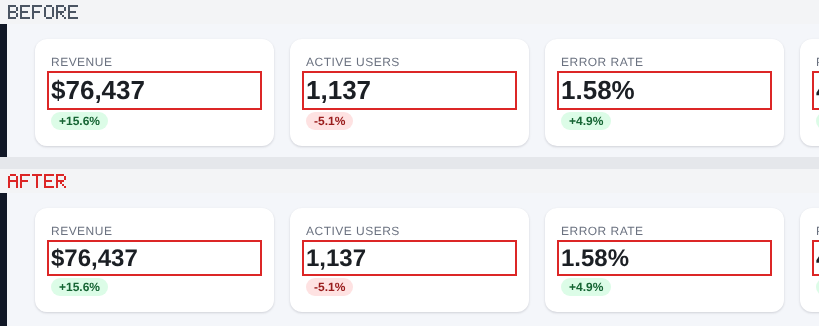

# uihash: research notes and results

How uihash works in detail, what it was tested on, and what did and did not work. For what uihash is
and how to use it, see the [README](README.md).

## Hashing a UI without hashing its data

A fingerprint of a rendered web page that **ignores content and randomness** (new emails, story
titles, counts, timestamps, avatars, rotating tips, random ids) but **changes on any visual
regression**: a colour, a padding, a font, an icon, a typo in a label, reordered elements. When it
changes, it says *where* and *what*, down to the CSS property:

```
$ uihash check "http://localhost:3000/inbox?seed=78" --schema inbox.schema.json
✗ base: UI changed, 3 error(s), 0 warning(s) (56.1ms)
✗ changed          html > body > div.layout > nav.side > button.compose[0]
    text: "Compose" → "Compse"
✗ unknown-variant  html > body > div.layout > main > ul.rows > li.row[*] > span.line[*]  (×2)
    row-gap: 6px → 8px
    column-gap: 6px → 8px
```

**The Gmail example.** Calibrate on 8 renders of a Gmail-like inbox with different data, then:

| inbox #7 | pixel SHA | uihash check |
|---|---|---|
| as is | `e95e7b0d2fb9` | ✓ same UI |
| one new email arrives at the top | `aea496cefde0` (changed) | ✓ same UI |
| three new emails arrive | changed | ✓ same UI |
| a new email + a regression in unread styling | changed | ✗ `li.row > span.sender  font-weight: 700 → 600` |
| a new email + 2px less row padding | changed | ✗ `li.row  padding-right: 16px → 14px` |

(`experiments/mailbox/index.html?seed=7&newmail=1`; reproduce with the CLI below.)

This is a research prototype built in one session. It has been tested on two synthetic apps with
known ground truth and on seven live websites (four used during development, three held out). The results, the design, and what did *not* work are
all below.

## Results at a glance

| test | false positives (same UI, different data) | visible regressions detected |
|---|---|---|
| Mailbox (Gmail-like), 20 data seeds + 2 UI states, 27 regression types × 5 seeds | **0 / 30** | **128 / 128** |
| Ops dashboard (charts, inline-styled bars, virtualized rows, relative times, random A/B), 16 regression types | **0 / 20** | **73 / 73** |
| 4 live sites (HN, Lobsters, Wikipedia, GitHub Trending): 160 random CSS mutations on live pages | n/a | **132 / 132**, all but one explanation name the mutated property |
| 3 held-out live sites, never used during development (arXiv, CNN Lite, npm): 120 CSS mutations | n/a | **104 / 104**, every explanation names the property |
| Live drift: 4 sites re-snapshotted every 15–17 min for 2 h 43 min, 40 checks | **2 / 40** (both Wikipedia content updates) | 4 / 4 real visual changes caught |
| Pixel diff / pixel SHA / DOM hash / naive style-tree hash on the mailbox | **30 / 30** (every data change flags) | 130 / 130 (trivially: they flag everything) |
| PR check with highlighted changes: 43 regressions of both testbeds, base vs. head build | n/a | **38 / 38** visible changes caught and boxed on the changed pixels (median 100 % of them inside the boxes) |
| Demo PR: 5 deliberate UI changes + 1 no-op refactor | **0** (the refactor is not flagged) | **5 / 5**, each with before/after crops and attributed to the right edit (the new button and the copy change also show in the accessibility tree) |
| 94 subtle changes (1px, z-index, ΔE < 1 colours, hover/focus/disabled-only, SVG strokes, canvas...) | 0 / 252 forced-state checks of fresh data | **66 / 66** that change pixels (Playwright's default comparison: 45 / 66), 22 / 23 that show only in another state |

On the live sites, once calibrated on a few earlier snapshots, the fingerprint passed hours of
content churn. The real changes it flagged were **HN's black memorial bar** appearing above the
header, **HN serving an "upstream request failed" error page**, the **Lobsters logo colour**
changing from `rgb(172,19,13)` to `rgb(98,0,0)`, and a **Wikipedia fundraising banner**. All four
came from configuration, not code deploys. Its only false alarms came from under-calibration (see
the drift results).

## Quick start

```bash
cd uihash && npm install            # playwright (Chromium)
# 1. calibrate: render the SAME build ≥ 6 times with DIFFERENT data/time/randomness
node bin/uihash.js calibrate "http://localhost:3000/inbox?seed={i}" --runs 6 --out inbox.schema.json
# 2. check any later render (other data is fine): exit 0 = same UI, 1 = changed (explained)
node bin/uihash.js check "http://localhost:3000/inbox?seed=77" --schema inbox.schema.json
# 3. or, with fixed fixtures (CI), one hash per render: identical across nondeterministic re-renders
node bin/uihash.js digest "http://localhost:3000/inbox?seed=1" --schema inbox.schema.json
```

`{i}` in a URL is replaced by 1..runs. `--json` gives machine-readable results for CI. Snapshots (`uihash snapshot url --out x.json.gz`) can be used
anywhere a URL can. Use `--keys tag` if class names are renamed between builds (see trade-offs below).

**Components that open and close.** There are two complementary ways to cover them:

```bash
# drive the UI into states by clicking; each state gets its own schema, check/digest replay the clicks
node bin/uihash.js calibrate "$APP?seed={i}" --runs 6 \
     --state 'menu=[aria-label="Settings"]' --state 'compose=nav button' --out inbox.schema.json
node bin/uihash.js check "$APP?seed=92" --schema inbox.schema.json
#   ✓ base: same UI   ✓ menu: same UI   ✗ compose: … div.composer[dialog][0]  width: 520px → 540px

# or, without interacting: also fingerprint closed menus/dialogs that stay in the DOM hidden
node bin/uihash.js calibrate "$URL" --runs 6 --latent --out site.schema.json
```

Latent mode reads the computed style of `display:none` / `visibility:hidden` / visually hidden
subtrees. On GitHub, 2,209 elements of closed UI sit in the page. Mutations to classes that exist
*only* in closed components are ignored in normal mode (0/26 across sites, correctly: nothing visible
changed) and caught in latent mode (GitHub 9/12, Wikipedia 9/12, Lobsters 2/2).

**When a flagged change is just data** (e.g. the first time an inbox has zero drafts and the
"Drafts" badge disappears), accept it the way you would update a snapshot test:

```bash
node bin/uihash.js approve "$APP?seed=54" --schema inbox.schema.json   # re-learns with this render
```

## Pull-request check (CI)

`uihash pr` compares a PR build with its base build. Each change found gets a before/after crop
with red boxes around the changed elements, and the results go into one sticky PR comment:

| ❌ `nav.side › button.compose` — `border-radius: 16px → 12px` | ❌ `div.toolbar` — `added child button.icon-btn` |
|---|---|
|  |  |

| ❌ `div.kpis › div.card.kpi › div.value` — `font-size: 26px → 24px` _(4 elements)_ |
|---|
|  |

Try it on the demo PR. It contains five deliberate UI changes plus a no-op refactor (a `display: contents` wrapper) that must not be flagged:

```bash
node ci/demo/make-pr.js /tmp/demo                    # base/ and head/ builds of the two testbed apps
node bin/uihash.js pr --base file:///tmp/demo/base/ --head file:///tmp/demo/head/ \
     --config ci/demo/uihash.config.json --out /tmp/demo/report
# ✗ Inbox / default: 4 error(s) ... → /tmp/demo/report/{report.html, comment.md, summary.json, *.png}
```

It reports exactly the five changes and ignores the refactor. For each page and state in the
config it does the following:

1. **Base:** renders the page with fixtures `{i}` = 1..6 and calibrates a schema. Fixture 1 is the reference, the "before" screenshot.
2. **Head:** renders fixture 1 once and checks it against the schema.
3. Because both sides render the same fixture, the boxes pair up element by element.

Time is frozen, `Math.random` is seeded, and the page counts as settled once the network is quiet and
two consecutive extractions agree. Every finding then gets the following treatment:

- **One finding per root cause.** A body `font-family` change is one finding with 486 boxes, not 486 findings.
- **Shadow-aware boxes.** Boxes cover what the element paints, including `box-shadow`, outline and blur.
- **Pixel check.** Each finding is compared at the pixel level. If the change renders identically in the CI
  browser, it is still reported but labelled "no pixel change here". Typical cause: a font or
  weight the CI machine doesn't have, which users on other machines will still see.
- **No repeats.** A change already shown for another state of the page is listed as a reference instead of shown again.
- **Scroll containers.** Boxes are clipped to what the screenshot can show. Elements below the fold of an inner scroll container,
  as in app shells like Gmail, are never boxed at the page coordinates they would have. A change that is entirely out of view
  is reported with a note instead of a crop (`experiments/scroller`).
- **New and broken states.** A page missing on the base build is reported as new. A state whose click target no longer exists is
  reported as broken.

**Config** (`uihash.config.json`, in the app's repo):

```json
{ "runs": 6, "viewport": { "width": 1280, "height": 800 },
  "pages": [
    { "name": "Inbox", "path": "inbox?seed={i}",
      "states": { "Settings menu": "[aria-label=\"Settings\"]", "Compose": "nav button" } },
    { "name": "Dashboard", "path": "dashboard?seed={i}" } ] }
```

The app should render fixture data chosen by the seed (a mock API, MSW, a fixtures mode). That is
how calibration learns which parts are data, such as email rows, counts and names. A page without
data variation still works; it is just compared more strictly. Other options: `keys` (`class`|`tag`),
`concurrency`, `freezeTime`, `seedRandom`, `networkIdleMs`, `imageBaseUrl`, and
`viewports: [{ "name": "desktop", "width": 1280, "height": 800 }, { "name": "mobile", "width": 390, "height": 844 }]`
to check every page state at each width. On the demo, a media-query change that only applies
below 600 px is reported for `mobile` only. A change that shows at every width is listed once.
`pseudoStates` (default `["hover", "focus"]`; also `"active"` or any pseudo-class Chromium can force,
such as `"disabled"` or `"user-invalid"`) adds a render of each page with those pseudo-classes forced
(see *Subtle changes* below). `media` adds emulated-media renders, e.g.
`[{ "name": "dark", "colorScheme": "dark" }, { "name": "print", "media": "print" }, { "name": "motion", "reducedMotion": "no-preference" }, { "name": "high contrast", "forcedColors": "active" }]`.
A viewport may emulate a device: `{ "name": "phone", "width": 390, "height": 844, "deviceScaleFactor": 3, "isMobile": true, "hasTouch": true }`.
A page may list the viewports it is checked at (`"viewports": ["phone"]`), and set its own `pseudoStates` and `media`.
A state is a list of actions: CSS selectors to click, `"hover:<selector>"` to move the mouse over an
element (JS hover handlers run), `"right:<selector>"` to right-click (context menus),
`{ "fill": "<selector>", "value": "text" }` to type into a field, and `"@hover"` / `"@focus"` / ... to force a pseudo-class once the rest is done,
e.g. `"settings open + hover": [".settings-btn", "@hover"]` shows a menu together with every tooltip, and
`"search": [{ "fill": ".search", "value": "e" }, ".search-go"]` shows search results.
`variants` adds quick checks of each page as loaded, compared on the same fixture only (2 base
renders and 1 head render, no calibration): another width (`{ "name": "tablet", "width": 900 }`),
longer text as translations make it (`{ "name": "long text", "textScale": 1.4 }`; short strings grow
more), or the text spacing users may set (`{ "name": "text spacing", "textSpacing": true }`, WCAG
1.4.12). Widths that a PR's media queries touch are added on their own (`mediaWidths: false` turns
that off), and the accessibility tree is compared on every state (`a11y: false` turns it off), as are
categorical colours (`palette: false`). `coverage: true` warns about CSS rules the PR changed that no
checked state uses (see *Beyond the configured states*). `explore: true` (or a number of controls, default 24), per
page or for all, also clicks every control of the page as loaded and compares the page after each
click, on both sides (see *Beyond the configured states*).
`quick: true` checks every target on the same fixture only: no calibration, and no need for
fixtures that vary by seed, at the cost of flagging a PR that changes the fixture data itself.

**GitHub Actions.** Copy [`ci/github/uihash.yml`](ci/github/uihash.yml) to `.github/workflows/`,
then set `INSTALL`, `BUILD`, `SERVE` and the path of this folder.

- **What it does.** It checks out the base commit and the PR merge commit, builds and serves both, runs `uihash pr`, uploads the
  report as an artifact, and posts or updates one comment.
- **Approval.** The check fails when the UI changed. Adding the label `ui-change-approved` marks the changes as intended and the check passes.
  The approval covers exactly the set of changes on screen when the label was added: each report carries a signature of its findings.
  A later push that changes anything else removes the label and fails the check again; pushes that leave the UI alone keep the approval.
- **Caching.** The base calibration is cached per base commit. A `baseline` job pre-fills the cache on every push to `main`, so a PR only renders its own build.
  That job also renders `main` against itself: any finding there is nondeterminism in the app that would cause false alarms.
- **Comment images.** Crops are pushed to a `uihash-assets` branch and linked as `github.com/…/blob/…?raw=true`.
  That form loads for signed-in readers of private repos, where `raw.githubusercontent.com` links do not.
  PRs from forks get a read-only token, so they get the report artifact and job summary but no comment.

On the demo, the full check covers 8 page states: the 4 configured ones plus forced hover and focus
for each page. That is 48 base renders and 8 head renders, and takes **~17 s** on 4 CPUs. With the base
cached, as on every push after the first, it takes **~7 s**: 8 renders, the check, and the images for
the 8 changed states.

**Does it box the right thing?** [`experiments/highlight/eval.js`](experiments/highlight/eval.js)
runs this flow for every regression type of both testbeds: 43 changes, 4 of them invisible on this
machine. Ground truth is the pixel diff between the before and after screenshots.

| visible changes detected | boxed on the changed pixels | changed pixels inside the red boxes (median / lowest) | inside red or dashed boxes (lowest) | boxes that contain changed pixels | "no pixel change here" label correct |
|---|---|---|---|---|---|
| **38 / 38** | **38 / 38** | **100 %** / 4 % | **99.8 %** | 100 % in 37 cases, 86 % in one | **42 / 42** |

**Layout shifts get dashed outlines.** Narrowing the sidebar moves everything to its right. The
sidebar, the cause, is boxed in red, but red boxes alone cover only 4 % of the changed pixels. Base
and head render the same fixture, so any element that kept its identity but changed its box was
pushed by a change. `src/shift.js` walks both trees in parallel and outlines those elements with a
dashed amber line. Only the outermost element of a block that moved together is outlined, plus
leaves that rewrapped. Containers that merely grew are not outlined. With these outlines, every
visible test change has at least 99.8 % of its changed pixels inside a red or dashed box. The
changes that move nothing get no outline (all 34 others). Example: a new toolbar button is red, and the "⋮" button
it pushed right is dashed in both its old and new positions.

### Subtle changes

[`experiments/subtle/eval.js`](experiments/subtle/eval.js) plants 94 changes of the kind that slip
through review: 1px font sizes, a half-pixel font size, `letter-spacing: 0.01em`, a one-unit colour
change, `opacity: 0.97`, a 1px padding, z-index changes, hover-only and focus-only styles, a removed
focus ring, dark-mode-only and print-only rules, `cursor` and `pointer-events`, SVG stroke details, a
redrawn `<canvas>`, a static label typo. Each change is labelled with where it shows. It runs through
the PR flow and is compared with the pixel diff of the same fixture.

| where the change shows | first run | now |
|---|---|---|
| changes pixels in the state it was checked in | 27 / 31 | **66 / 66** |
| real, but no pixel change on the CI machine (OpenType features, font width, scrollbars...) | 6 / 11 | **16 / 17** (a style inside `prefers-reduced-motion: no-preference`: see below) |
| only in another state or environment: hover, focus, active, disabled, `:user-invalid`, dark, print, `::selection`, forced colours, a touch phone, HiDPI | 2 / 10 | **22 / 23** |
| not drawn at all: `cursor`, `pointer-events: none`, `user-select`, `transition` | 0 / 4 | **3 / 4** (transition timing is frozen while capturing) |
| no visible effect anywhere (z-index on an element that overlaps nothing, radius 999 → 998px, an icon path rewritten with arcs) | 4 flagged | 4 of 6 flagged, all labelled "no pixel change here" |

**Against screenshot diffing, on the same renders.** Each case's before/after screenshots also go
through Playwright's own comparator ([`pixeltools.js`](experiments/subtle/pixeltools.js)) at the
documented defaults. That is the best case for a screenshot suite: it is handed every state uihash
renders.

| of the 66 changes that alter pixels | caught |
|---|---|
| uihash | **66** |
| Playwright ssim-cie94 (experimental comparator) | 56 |
| pixelmatch at 0.063 (Chromatic's default `diffThreshold`; Chromatic runs its own service, so this is an approximation) | 52 |
| pixelmatch at 0.1 (pixelmatch's default) | 47 |
| Playwright `toHaveScreenshot` default (threshold 0.2, no pixels allowed) | 45 |
| Playwright 0.2 with `maxDiffPixels: 100` (the tolerance in Playwright's docs example) | 40 |

Playwright's default passes 21 of them. Some are imperceptible (ΔE00 0.4–0.6 colour tweaks). Others
are not: a hover background at ΔE00 5.9 ("clearly visible"), an active state at 5.6, two changes that
fail WCAG AA contrast, `stroke-dasharray` on chart grid lines, a redrawn canvas sparkline, and a 1px
background-position shift. The YIQ threshold is lenient for light colours, and anti-aliased pixels
are ignored, so a 1px corner radius change passes every pixel tool.

Gaps found and closed along the way:

- **Properties nobody read.** Kerning, `font-variant-numeric`, `font-feature-settings`, `font-stretch`,
  underline offset and thickness, the individual `scale`/`translate`/`rotate` properties, `zoom`,
  `content-visibility`, masks, border images, multi-column, scrollbar styles, `::placeholder` and
  `::selection`; SVG stroke and fill details (`stroke-linecap`, `stroke-dasharray`, `stroke-opacity`,
  `fill-opacity`, markers, gradient stops), read on the shapes they can draw on and never skipped as
  undeclared, because presentation attributes set them. A kerning change alone moved 51,630 pixels.
  Typography is read only where text is drawn and interaction properties only on interactive
  elements, so extraction stays cheap.
- **`<canvas>` content.** A canvas is pixels only; its content is now hashed.
- **States a static render never shows.** Forced pseudo-classes, as in the DevTools ":hov" panel
  (`CSS.forcePseudoState`), are applied to every element a rule for that pseudo-class targets, plus
  every interactive element. Each page gets `hover` and `focus` renders by default (`pseudoStates`);
  any pseudo-class Chromium can force works (`disabled`, `checked`, `user-invalid`, `open`, ...). A
  state may also click, hover (`hover:<selector>`) and then force (`@hover`), e.g. a menu opened with
  its tooltips showing. Over 252 checks of fresh data in six states there were 0 false alarms.
- **Environments.** `media` variants emulate `colorScheme`, print, `forcedColors` and
  `reducedMotion`; `viewports` may set `deviceScaleFactor`, `isMobile` and `hasTouch`, so
  `(hover: none)` and `(min-resolution: 2dppx)` rules are checked too. Renders prefer reduced motion
  (steadier), so a style that only exists under `prefers-reduced-motion: no-preference` needs the
  `{ "name": "motion", "reducedMotion": "no-preference" }` variant.
- **Interaction.** A button that gets `pointer-events: none` looks identical and no longer works.
  `cursor`, `pointer-events`, `user-select` and `touch-action` are compared.
- **Assets replaced under the same name.** Same-origin images, CSS `url()` images and `@font-face` files
  are hashed by content; a bundler fingerprint in the file name or a cache-busting query does not count.
  [`experiments/assets`](experiments/assets/eval.js) passes on a logo, a texture and a font file
  swapped under unchanged names. URLs are recorded relative to the page, since base and head are
  served from different places.

Checks that say how much a subtle change matters:

- **How different a colour change looks.** Each colour change is labelled with its CIEDE2000
  difference: below 1 is "imperceptible", up to 2 "barely perceptible", up to 5 "noticeable side by side",
  above that "clearly visible". The implementation matches the 12 published test pairs checked
  (Sharma, Wu & Dalal 2005).
- **Contrast crossing WCAG AA.** A text element that met AA (4.5:1, or 3:1 for large text) against its
  effective background in the base and fails it in the PR is an error. `#767676` → `#777777` (ΔE00 0.4)
  drops 4.54:1 to 4.48:1 and is flagged; so is a darker ancestor background, and a dark-mode-only rule
  that darkens the page but not the text (5.69:1 → 2.66:1 on 20 elements).
- **Focus indicators (WCAG 2.4.7 Focus Visible).** The page as loaded and its `:focus`-forced render
  have the same DOM, so they pair node for node: a focusable control whose subtree is styled
  differently when focused has a focus indicator. A control that had one in the base and has none in
  the head is reported ("no visible focus indicator any more on 48 focusable elements"). The classic
  `:focus { outline: none }` reset is caught; a ring replaced by a box-shadow is not reported; 0 false
  alarms over 42 checks of fresh data ([`focus.js`](src/focus.js)).
- **Layout relations a change breaks** (after X-PERT, GWALI and ReDeCheck, which compare relations
  between elements instead of pixels). Both sides render the same fixture, so data cannot trigger these:
  - content newly cut off or scrolling: a sender column narrowed to 90px gives "113px of content in 90px";
  - in-flow siblings that newly overlap: a `-10px` margin overlaps the chips with the subject in 20 rows;
  - elements newly wider than the viewport: "right edge at 1572px, viewport 1280px";
  - text or interactive elements newly covered by another element (`document.elementFromPoint` at the
    centre): what a z-index change does when it matters, e.g. "div.toast now under polyline";
  - fixed-position elements newly past the window, where no scrolling brings them back, such as a
    context menu that no longer flips up;
  - **invisible but still clickable** ([`ghost.js`](src/ghost.js)): hit testing ignores opacity, so
    content hidden with `opacity: 0` instead of `visibility: hidden` still takes clicks, and a modal
    backdrop faded out but left in place blocks the page. No screenshot shows either. Elements that
    are invisible and hit-testable in the head but were not in the base are reported, on every state,
    since the screenshots are identical;
  - **broken alignment**: edges that lined up with their neighbours (left, right, centre, top, bottom,
    middle of what is drawn) and are now 0.5 to 3px apart. People see a break between edges that
    should be collinear at hyperacuity scale (vernier acuity: seconds of arc, while a CSS pixel is
    about a minute) but hardly notice a whole region moving a pixel. One KPI label 1px lower than its
    three siblings is reported as "top edges of div.label and div.label (3) no longer line up (1px
    apart)"; quiet on 30 of 32 other regressions of the testbeds.
- **No pixel change, but moved.** The "no pixel change here" label is not given when the element moved,
  or when a layout-affecting change shifted other content.

Still not caught: a 0.5px border, because Chromium computes and draws it as 1px even at device pixel
ratio 2 (Safari draws a hairline: a cross-browser difference out of reach of a Chromium-only check);
transition and animation timing; and anything that changes behaviour without changing a style (a
removed click handler).

### Comparing like with like

Base and head render the same fixture, so some checks need no calibration at all. They catch what a
fingerprint built to let data vary lets through: a regression that only changes data-like things.

- **Pixel hashes as a safety net.** `pr.js` hashes both screenshots (about a millisecond). Identical
  hashes mean nothing changed pixels in that state. Different hashes with a passing style check mean a
  change the fingerprint treats as data, such as an indicator now coloured like another variant it
  already had. The paired walk then names the elements whose own style or text differs for the same
  data ("(same data, drawn differently)"). A second base render of the reference fixture (cached with
  the base) measures what varies anyway, and those elements are left out. Chromium's `outline: auto`
  focus ring varies by a few pixels in about one render in four, which is why the pixel hash only
  triggers the element walk and never reports by itself.
- **Text as written.** Digits are normalized so that any value fits a learned hole, so a wrong total
  or a lost decimal looks like data. For the same fixture, the paired walk compares text as written,
  with version strings and commit hashes masked.
- **Elements on one side only.** Templates let lists vary in length. For the same fixture a different
  count is a change, so elements on one side only are reported, described by what they hold
  (`added: N × li ("…", …)`). A missing element is described by what it held in the base
  (`missing: div.x ("…", "…")`).
- **Controls inventory.** `uihash controls <old> <new>` lists the buttons, links and fields one page
  has and the other lacks. Run against an old UI and its rebuild on the same data, it lists what the
  rebuild dropped.

**No calibration at all** (`quick: true`). The same-fixture checks alone compare everything visible on
that fixture: the pixel hash; the paired walk, with text as written and elements on one side only;
layout relations; invisible-but-clickable elements; the accessibility tree. The walk also runs when
the pixels are identical, so style changes that draw nothing still show. The base takes 2 renders per
state instead of 7.

What calibration still buys:
- a PR that changes the fixture data itself passes, where quick mode flags every changed value;
- pages whose data cannot be pinned, such as live sites, can only be checked against a learned
  fingerprint.

Quick mode lowers the setup bar: one deterministic fixture is enough.

### Beyond the configured states

A survey of techniques ([PRIOR-ART.md](PRIOR-ART.md), fourth round) led to the checks below. All of
them rely on base and head rendering the same fixture, so they need no calibration.

**Widths a PR's media queries touch.** A rule inside `@media (max-width: 900px)` changes nothing at
1280px, so a check there is right to pass. The extractor records each media block that has a width
condition (the condition and a hash of its rules). When the base and head blocks differ, `pr.js` adds a
quick variant at the edge of that block's range, unless a configured viewport already lies inside it.
ReDeCheck-RM found the widths either side of breakpoints the best places to look. Each such width costs
3 renders; a PR that touches no media query costs none.

**The accessibility tree** ([`src/a11y.js`](src/a11y.js)). These change no pixel and no style:
- a button whose `aria-label` was dropped;
- a list marked `aria-hidden`;
- a toggle that no longer reports that it is pressed.

Base and head render the same fixture, so their accessibility trees should be identical. The trees are
Playwright's ARIA snapshots: role, accessible name and states, one line per node. Lines that differ are
reported, except lines that also differ between two renders of the base. On the demo PR, the renamed
footer link shows up here as well: `link "Program Policies" → link "Program policies"`.

**Colours that are now hard to tell apart** ([`src/palette.js`](src/palette.js)). Many UIs tell
categories apart by colour alone: legend swatches, chart series, status colours. uihash reports every
colour change. This check adds whether two categories now look alike:
- A categorical set is the elements at one path whose colour takes 3 or more distinct values, such as
  legend swatches.
- A pair is reported when its CIEDE2000 distance was 10 or more in the base and is below 10 in the head.
  Small marks need larger differences than side-by-side patches (Szafir 2018).
- The distance is checked for normal vision and under simulated protanopia, deuteranopia and
  tritanopia (Machado et al. 2009, as in Chrome's emulation).

**Text stress**, as opt-in variants. A fixed width that fits today's English is a CSS change, and uihash
reports it either way. The variants add what it breaks, as content now cut off or overlapping:
- with text 40 % longer (80–150 % for short strings, as in Microsoft's pseudo-localization guidance);
- with WCAG 1.4.12 text spacing.

**Content that jumps while the page loads.** The final frame can be identical while users watch the
page jump: an announcement banner inserted after a fetch, an image without dimensions, a row added
late. Each compared render records the layout shifts while it loaded (the Layout Instability API, as in
Cumulative Layout Shift). Elements that moved 3px or more in the head, in neither base render, and with
a higher score are reported (`now shifts while loading: layout shift … → …; moved: …`), however small
the score: a list jumping a few dozen pixels scores far below the 0.1 that CLS calls poor.

**Fonts and values that failed to load.** A web font whose file was not deployed changes the
font-family hash, which explains nothing to a reviewer. It is now reported by name: `web font "Brand"
failed to load; text falls back to another font` (from `document.fonts`). Text that a template filled
with a missing value (`undefined`, `NaN`, `null`, `[object Object]`, `{{ … }}`) is marked as such
where it is compared on the same fixture, and the fingerprint already flags data holes that render
`undefined`.

**States nobody configured: clicking every control** (`explore: true`, [`src/explore.js`](src/explore.js)).
Configured states cover what someone thought to configure. Exploration does without them. It lists the
page's controls in base and head and pairs them by path and label. Repeated controls, such as a menu
button on every row, are clicked once. Each control is clicked once on both sides, and the resulting
states are compared like configured ones. A control that changed the page in the base (its pixels or
its URL) and does nothing in the head is reported as dead.

Exploration misses what takes more than one plain click: two or three clicks in sequence, a hover, a
right-click, typing into a search box, and a click handler on an element that does not look clickable
(no `cursor: pointer`, no role). It is opt-in, because it costs about four times the renders.

**What the check did not see** (`coverage: true`). A regression inside a state nobody configured passes
silently. With coverage on, each compared render records which style rules it used (Chrome's
`CSS.startRuleUsageTracking`). The full rule list comes from the stylesheets' text, so no source maps
are needed. Rules the PR added or changed that no checked state of any page used are then listed as a
warning (`a changed rule no checked state uses: …`). Changes made by scripts cannot be seen this way.

Two details of the explanations:
- A missing list item is named (`missing: expected button ("…") not found`), where comparing position
  by position would report a text change.
- Findings that add or remove elements come first, and text styles that only came or went with an
  element's content are left out.

### Intended or not

uihash reports every difference between base and head, and most of the differences in a PR are the
ones its author meant (85 % of the behavioural differences Testora's authors labelled, [PRIOR-ART.md](PRIOR-ART.md),
fifth round). What a reviewer needs is the few that are not. No tool decides this from the pixels.
uihash now gives every finding a **triage label** from two things it can establish: what the change
breaks or takes away, and which edit of the PR it comes from.

| label | meaning | how |
|---|---|---|
| 🚫 **breaks** | a property the UI keeps whatever the design | layout relations, contrast, focus, clicks, fonts, broken values (as before), and the new checks below |
| ⚠️ **check** | likely unintended | an element, item or accessible name gone; text newly truncated; one instance drifting from the others; numbers that changed on the same data; a CSS edit reaching an element its rule does not select, or winning only by `!important` |
| 🎨 **token** | from a redefined custom property | attribution |
| ✏️ **yours** | from a CSS edit whose rule selects the element (or an ancestor) | attribution |
| ▫️ **other** | from markup, a script or data, and not a loss | attribution |

The PR comment opens with the counts and, when anything is labelled 🚫 or ⚠️, a "look at these first"
list. Every finding says where it comes from. From the demo PR:

```
🎨 1 through a design token · ✏️ 2 from your CSS edit · ▫️ 3 markup, script or data change

1. ❌ ✏️ div.layout › nav.side › button.compose[0] — border-radius: 16px → 12px
   from your CSS edit. From rule `.compose`: border-radius: 16px → 12px.
3. ❌ 🎨 main › ul.rows › li.row — background-color: rgb(255, 255, 255) → rgb(251, 253, 255) · ΔE00 1.3,
   barely perceptible (8 elements)
   through a design token. Through `--row-unread`, redefined in rule `:root`: --row-unread: #ffffff → #fbfdff.
4. ❌ ▫️ footer › div[0] › a — text: "Program Policies" → "Program policies"
   markup, script or data change. Not from a CSS change: the markup, a script or the data changed.
```

**Where a change comes from** ([`src/attribute.js`](src/attribute.js)). For each page state with
findings, the base and the head are rendered once more and their stylesheets read through the
DevTools protocol (`CSS.getStyleSheetText`). The sheets are paired (linked ones by path, with content
hashes taken out of file names; inline ones in order, anchored on unchanged sheets) and diffed rule by
rule: a rule changed in place, added or removed is one edit, a whole sheet missing is one edit. Then, in
the live head page, each edit is undone on its own with `CSS.setStyleSheetText` (no reload: the DOM,
the scripts and the state stay), the page is extracted again and checked against the base again. A
finding that goes away when an edit is undone comes from that edit; one that survives undoing every
edit at once comes from markup, scripts or data. This is delta debugging (Zeller 1999) over the CSS
diff, at rule granularity, and it needs no source maps: it works on the CSS the browser loaded. Each
edit's selector is matched in the page as well, which tells how the edit reaches an element: through a
rule that selects it, inside an element it selects, through a custom property it redefined (a design
token), or otherwise (a knock-on). Where an edit's `!important` declarations now beat a rule the PR
did not touch with a more specific selector, the finding says so: the cascade inversion that Mazinanian et
al. describe for reordered rules, found here from specificity.

On the demo PR, whose five deliberate changes are real source edits, every finding is attributed
correctly: `border-radius: 16px → 12px` to the edited `.compose` rule, the unread-row tint through
`--row-unread` redefined in `:root`, the KPI font size to `.kpi .value`, and the new toolbar button and
the copy change to markup. Nothing is flagged, and the no-op refactor still is not reported.

**What a change takes away** ([`src/loss.js`](src/loss.js), [`src/shift.js`](src/shift.js)). A
redesign restyles things; a regression more often loses something. Base and head render the same
fixture, so these compare like with like:

- **Distinctions.** Things of one kind that looked different in the base and look the same now:
  selected and unselected items drawn alike, status colours that all turned grey, labels that all
  read "N/A".
- **States.** For every element with a class that names a state (on, active, selected, current,
  reviewed, …), the live page is asked what it looks like without that class. A state that changed the
  look in the base and changes nothing in the head is lost, even with one such element on the page: an
  "on" switch that now looks like "off".
- **Hover feedback.** Elements whose own style changes when hovered in the base and not in the head.
- **Round trips.** A state that looked exactly like the page as loaded in the base (a change undone, a
  menu opened and closed) and no longer does.
- **Instances that drift.** Elements of one kind that were identical in the base, where the head
  changed some and not the others: rows past a certain index not drawn, one item without its indent.
  A regular pattern (every other row: zebra stripes) and changed instances that carry a class the
  others lack (status colours) count as deliberate.
- **Siblings that no longer match.** Items of a toolbar row that draw a box and shared a height, text
  blocks of one tag that shared their type style: one button now shorter than the others in its row,
  the two halves of a heading now in different weights.
- **New layout breaks.** A menu cut off by a container that does not scroll; content pushed past the
  bottom of a page that does not scroll; an image that no longer loads, is now drawn larger than its
  pixels, or is cropped; a highlight no longer over the text it marks. A list sorted differently is one
  "reordered" change instead of a change per row.

**Declared intent.** `--expect-no-change` (in CI: a PR titled as a conventional-commit refactor,
chore, build, ci, test, docs or perf change, or labelled `no-ui-change`) lists every finding as at least
"check": a refactor that changes the UI did something its author did not say.

**Cost.** Each distinct change is attributed once, in the first state that shows it; other states
with the same change take its cause. Attribution adds a few seconds to a PR check (`attribute: false`
turns it off).

**What the labels cannot do.** They cannot tell a deliberate 4px margin from an accidental one. A direct
edit that is itself the regression looks like any deliberate edit, and a token change reaches every use
of the token whether or not that was wanted. Only the PR's stated purpose says which. A language model
that compares the findings, as text, with the PR's title and description could supply that as advice
(never as an approval); it is not built in.

## How it works

### 1. Hash the intent, not the pixels

Layout is a deterministic function of (DOM, computed style, content, fonts, viewport). So the
fingerprint hashes the **computed style of every rendered element** and leaves pixels alone. It reads
values through the **CSS Typed OM** (`el.computedStyleMap()`), which returns *computed* values (`auto`,
`50%`, `1fr`). `getComputedStyle` returns *used* values (`123.56px`), and those depend on content.
A longer subject line can't change the hash, but any CSS edit that changes any element's style can.

The extractor also canonicalizes:
- **Dead-property elimination.** Properties that cannot paint are dropped: border colour with no
  border, flex-item props outside a flex parent, vertical padding on an unpainted inline box,
  padding on table rows, radius with nothing to round, and so on. A CSS change with no visual effect
  then doesn't change the hash.
- **Text styles are recorded where text renders.** Only elements that actually draw text carry
  font and colour (their full effective values), not wherever the style happens to be declared.
  Values inherited from a data-driven inline style are tracked as such.
- **Visually hidden content is pruned**: sr-only skip links, `opacity: 0`, off-page elements.
- **Data types in text are normalized**: numbers → `#`, month and day names, relative times
  ("3 minutes ago", "just now") → tokens. "1–34 of 1,839" and "1–50 of 2,345" become the same string.
- **Layout-neutral wrappers are flattened**: `display: contents`, and plain blocks with no box of
  their own. Adding a wrapper div is a refactor, not a visual change.
- The extractor **skips reading properties the canonicalizer would drop anyway** (lazy mode). It is
  1.2–1.8× faster, and the hashes were verified identical to full extraction on 7 real pages.

### 2. Name things stably

Each element gets a **key**: tag + stable classes + role/`data-testid`. Classes are not visual, since
their effect is already in the computed style; they only *name* things. **State classes** (`unread`,
`active`, `on`) are learned during calibration as the classes that differ between instances of the
same thing, and are dropped from keys. Generated class names (`css-1x2y3z`, `sc-…`) are dropped too,
and CSS-module hashes are stripped (`NavDropdown-module__icon__Tkl8_` → `NavDropdown-module__icon`).
Same-key siblings form a **group**. A group split by a unique "landmark" sibling becomes two groups:
the system nav items above the "Labels" heading are different from the user's labels below it.

### 3. Learn what is data by anti-unifying several renders

Calibration renders the same build several times with different data, time and randomness (use ≥ 6;
see the learning curve). The trees are then aligned top-down:

- **Static vs dynamic.** A position whose subtree hashes are identical in every run is *static*
  and checked by exact hash. Otherwise it is *dynamic*.
- **Tuple vs list.** A sibling group is aligned as **static prefix + variable middle + static
  suffix**. The middle (email rows, stories, table rows) is pooled into one *template* position,
  whatever the number of instances. Prefix/suffix items that look like middle items are pushed back
  into the middle, so a top story that happened not to change isn't frozen. *Inside* a template, if
  ≥ 90 % of instances have the same number of same-key siblings (HN's subtext links: user, age,
  hide, comments), they form a per-row tuple: each index is its own pooled position, so "hide"
  stays checked copy instead of joining the user names in one hole.
- **Holes.** At a dynamic position, a property becomes a *hole* (data) if: it varies at a singleton
  position (rotating tip, avatar); it's **text inside a template** (data flows into text); it's an
  image source or input value; it's set by a **data-driven inline style** (progress bar width, label
  colour, virtualized-row `transform`); or it's a style with more than K distinct values. **Other
  style variation inside a template is a state** (unread bold, starred) and is kept as a variant.
- **Holes are typed, not "anything goes".** A data hole still rejects what a data-binding bug
  renders: a text run that is exactly `undefined`, `null`, `NaN`, `[object Object]` or `Invalid Date`,
  or unrendered template syntax (`{{ … }}`, `${…}`). A title like "Undefined behavior in C" is fine.
  Without this, a sender rendering `undefined` passed (0/5); with it, 5/5, and still no false
  positives on any testbed or live site.

### 4. The fingerprint is a set, and the check is containment

> **No single hash of a page can be invariant to *which* variants the data happens to show (no
> unread mail today) and still be sensitive to changes *inside* those variants.** Suppose h({read}) =
> h({read, unread}) is required for data invariance, and h({read}) = h({read, unread′}) too, since a
> page without unread mail looks the same before and after a regression in unread styling. Then
> h({read, unread}) = h({read, unread′}), so the regression is invisible.

So a dynamic position stores the **set of known facts** (own props minus holes, text unless a hole,
child shape), and the check is:

```
required  ⊆  candidate  ⊆  known
```

The candidate must contain what was always there and nothing that was never there. Static positions
are plain Merkle-hash comparisons. Positions or variants never seen are reported as `new-element` /
`unknown-variant`, with a diff against the closest known exemplar. Insertions and removals are aligned
by shape and reported as such (e.g. "new `tr` inserted before the header row" for HN's black bar).

### 5. A single hash, when the data is fixed

In CI the fixtures are fixed, but some nondeterminism usually leaks through (clock, random ids,
rotating copy). `digest(snapshot | schema)` is the Merkle root of the canonical tree with the
schema's holes masked and templates pooled as *sets*. Two renders of the same fixture give the
**same digest**: 5/5 on the mailbox, despite random tips and ids. Every visible regression changes
it (128/128). Comparing two builds is one string compare.

## Experiments

All numbers are reproducible from `experiments/`: `npm run eval:mailbox`, `eval:dashboard`,
`eval:live-mutations`, `eval:latent`. Synthetic testbeds are deterministic up to their own deliberate
randomness. The live-site numbers depend on what the sites serve when you run them; the drift series
was captured during the session with `capture:live` every 15–17 minutes.

**Mailbox testbed** (`experiments/mailbox`, a Gmail-like app driven by a seeded data generator;
6 calibration renders per UI state, all scenarios re-rendered from scratch for the final numbers):

| method | FP: 30 data variations | FP: 15 refactors | visible regressions |
|---|---|---|---|
| pixel SHA-256 | 30/30 | 15/15 | 130/130 (flags everything) |
| pixel diff > 0.5 % | 30/30 | 15/15 | 130/130 (flags everything) |
| dHash (perceptual, d > 4) | 13/30 | 6/15 | 66/130 |
| DOM `outerHTML` SHA | 30/30 | 15/15 | 130/130 |
| style tree (used values + boxes) | 30/30 | 15/15 | 130/130 |
| style tree (intent + normalized text), no calibration | 30/30 | 15/15 | 130/130 |
| **fingerprint, class keys** | **0/30** | 5/15 (class-rename only) | **128/128** |
| **fingerprint, tag keys** | **0/30** | **0/15** | **128/128** |

A reproducibility note: with only 3 calibration renders per state, a fresh re-render produced 5/30
findings. All were *warnings* from one 1-in-9 event: the 3 menu-state calibration renders happened to
show the same random tip, so its text was learned as constant. At 6 renders it is 0/30 again.

The two "misses" in 130 are renders with no attachment rows, so the attachment-icon change isn't on
screen. The 27 regression types include four data-binding bugs that land *inside* data holes (a
sender rendering `undefined`, a raw `{{ email.subject }}`, an empty sender, `NaN` in a count); see
"typed holes" in How it works. `hover-bg` is invisible in any static render. The empty inbox (`n=0`) is reported as a new
state; 1, 2 and 150 rows pass.

**How many calibration renders?** Held-out rates (tag keys, 10 random draws each), counting any
finding vs. errors only:

| renders | 1 | 2 | 3 | 4 | 6 | 8 |
|---|---|---|---|---|---|---|
| false positives, any finding | 100 % | 45.4 % | 3.9 % | 10.5 % | 4.5 % | 5.6 % |
| false positives, errors only | 100 % | 29.6 % | 3.9 % | 3.6 % | 4.5 % | 5.6 % |
| detection, any finding | 100 % | 100 % | 100 % | 100 % | **100 %** | **100 %** |
| detection, errors only | 99.3 % | 93.4 % | 91.5 % | 91.5 % | **100 %** | **100 %** |

**Use ≥ 6 renders.** At 6 and 8 renders every false positive is the same held-out render: the one
fixture in which a navigation item lacks a child that every other render has (`removed child span`),
a data variant the schema has not seen. It passes once a render like it is part of the calibration, as
in the main mailbox evaluation (0 / 30). The bump at 4 is one draw whose four renders all showed the
same random tip, so the tip was learned as constant (warnings only). Six is also what DoDOM needed (6
runs), and it is Daikon's evidence threshold: a 3-way random value stays constant over 6 renders with
probability 3⁻⁵ < 0.01. At 6, text-only changes count as errors, not warnings.

**Severity.** A text-only change at a position calibration saw constant is a *warning* while the
schema has fewer than 6 renders. Inside a template, an unseen combination of known children (an
optional chip missing) is also a warning. Style changes, structural changes to chrome, and
suspicious data are always errors. `check` fails on errors (`--strict`: on warnings too).

**Ops dashboard** (`experiments/dashboard`, built second to check for over-fitting): SVG chart
geometry from data, inline-styled bar heights, virtualized rows positioned by inline transforms,
relative times, money and percent formats, a random A/B layout and a randomly present toast.
Ground truth for "visible" is a pixel diff of mutated vs. unmutated renders with `Math.random`
pinned.

| keys | FP (20 data seeds) | block-wrapper refactor | visible regressions | pixel-invisible but flagged |
|---|---|---|---|---|
| class | **0/20** | 0/5 | **73/73** | 5/7 (600→700 weight with no semibold face installed) |
| tag | 0/20 | 0/5 | 50/73 (63/73 with a looser 80 % per-row-tuple bar, which costs 5.8 % false positives at 4 calibration renders) | 5/7 |

**Live sites** (`experiments/live`). 160 class-level CSS mutations were injected into live page
loads: colour shifts, +4px padding, font-size/weight, radius, `display:none`, letter-spacing,
underline, opacity. Ground truth is pixels inside the mutated elements' boxes, before vs. after.

| site | visible mutations detected | explanation names the property | pixel-invisible but flagged |
|---|---|---|---|
| Hacker News | 36/36 | 36/36 | 0/4 |
| Lobsters | 35/35 | 35/35 | 0/5 |
| Wikipedia | 29/29 | 29/29 | 2/11 |
| GitHub Trending | 32/32 | 31/32 | 0/8 |
| *held out:* arXiv listing | 36/36 | 36/36 | 0/4 |
| *held out:* CNN Lite | 33/33 | 33/33 | 6/7 (colour of list markers the pixel diff didn't register) |
| *held out:* npm | 35/35 | 35/35 | 1/5 |

"Pixel-invisible but flagged" went from 24/28 → 10/28 → 2/28 as text-style liveness and
hidden-content pruning were added.

**Text and structure on live pages** (`live-dom-mutate.js`). Ground truth comes from the 3-hour
series: text unchanged in *every* snapshot is chrome, text that changed is data. One-letter typos
and element removals were applied to 6 picks of each, and only errors were counted:

| site | chrome typo | chrome removal | data typo | data removal |
|---|---|---|---|---|
| Lobsters | 5/6 ¶ | 6/6 | 4/6 † | 6/6 ‡ |
| Wikipedia | 6/6 | 6/6 | **0/6** | 2/6 ‡ |
| GitHub Trending | 6/6 | 6/6 | 6/6 † | 6/6 § |
| Hacker News | 3/6 ¶ | 6/6 | 4/6 † | 6/6 ‡ |

- † Typos in template words around the data ("34 points" → "34 pxints", "3 hours ago", "576 stars
  today"). The normalizer treats "points", "stars" and "hours ago" as UI copy, so these are correct
  detections.
- ‡ Removing one field from one row (a username, a score) or part of a blurb is a structural anomaly
  in that template and is flagged.
- § GitHub Trending did not change once in 3 hours, so by the evidence the whole page is chrome.
- ¶ Every miss is content that stayed on the page for all ~3 hours: on HN, two story titles and a
  username; on Lobsters, a comment count. It is data the ground truth mislabelled as chrome. Before
  per-row tuples, HN's classless subtext links (user, age, hide, comments) shared one template slot
  whose text was a hole, and the per-row "hide" link was missed as well.

The **drift** test re-snapshots the same pages over ~3 hours. The page structure stayed put while
titles, scores, ages, avatars and trending repos changed. Calibrating on the earlier snapshots and
checking the next one, the fingerprint passed content churn and flagged exactly these changes:

| when (UTC) | site | finding | what happened |
|---|---|---|---|
| 00:15 | HN | `inserted: new tr before tr[0]` | black memorial bar added above the header |
| 00:15 | Lobsters | `header … background-color: rgb(172, 19, 13) → rgb(98, 0, 0)` | logo square turned dark red |
| 00:32 | HN | `body children: [center] → [pre]` | "upstream request failed" error page |
| 00:36 | Wikipedia | `new-element div.frb…`, `padding-bottom: 0px → 120px` | fundraising banner for US readers |

Over the whole series, 23:40–02:23 UTC (each snapshot checked against all earlier ones, i.e. online
learning, from the 4th snapshot on): **40 checks, 34 correct passes, the 4 real changes above
caught, and 2 false alarms.** Both false alarms were Wikipedia content updates in regions that hadn't changed during
calibration: the main-page layout that changes at midnight UTC, and the "Recent deaths" list at
01:53, whose entries switched between `span.nowrap` and plain links. Early on, calibrating from two
snapshots taken seconds apart also failed, because there was no variation to learn from.

**Speed** (live pages, same load, best of 4, end to end per check):

| site | elements | fingerprint: extract + transfer | + check | **= total** | pixels: full-page screenshot | + decode & compare | **= total** |
|---|---|---|---|---|---|---|---|
| Hacker News | 818 | 63 ms | 15 ms | **78 ms** | 108 ms | 54 ms | **162 ms** |
| Lobsters | 790 | 96 ms | 14 ms | **110 ms** | 149 ms | 104 ms | **253 ms** |
| Wikipedia | 1147 | 108 ms | 24 ms | **132 ms** | 371 ms | 202 ms | **573 ms** |
| GitHub Trending | 1069 | 147 ms | 17 ms | **164 ms** | 241 ms | 89 ms | **330 ms** |

(The check column was re-measured after the canonicalization speed-ups below, on stored snapshots
of the same pages; it was 27–37 ms before.)

That's 2–4.3× faster than screenshot + pixel compare, not orders of magnitude. The cost is reading
computed styles inside the browser (~1.5 µs per property read; lazy reading halves the reads).
Returning the snapshot as one JSON string instead of an object made the round trip 2.6–3.5×
faster, because Playwright's structured serializer was costing more than the extraction. The bigger
wins are zero data noise, property-level explanations, and baselines 29–90× smaller (a gzipped
schema of 4–28 KB vs one 211 KB–1.3 MB full-page PNG per state).

Where the remaining time went, and what fixed it. Each change was checked to produce identical
canonical hashes, schemas, digests and findings on all 395 stored snapshots (`build` in three
modes, plus 18 calibrations):

| change | effect |
|---|---|
| memoize per-element style canonicalization by (style, parent display, tag); styles are interned, so most elements reuse a result | canonicalization 2–4.5× faster |
| classify each CSS property once in a lookup table instead of ~12 regex tests per property per element; return a fresh object instead of one with deleted keys, which V8 keeps in slow dictionary mode | canonicalization another 1.5–1.8× faster |
| compute each node's sorted property string once; compute each node's fact once per calibrated position | calibration up to 1.4× faster |
| `crypto.hash()` one-shot SHA-1 (same digest, no Hash object per call) | hashing 2.5× faster |
| **total**: calibrate 6 renders / check one render | mailbox 279 → 108 ms / 34 → 13 ms; HN 383 → 99 ms / 42 → 14 ms; Wikipedia 511 → 180 ms / 46 → 24 ms |

The properties added for subtle changes (typography features, `zoom`, masks, `scale`/`translate`/`rotate`...)
first made extraction 32–54 % slower. Most pages never declare them, and a property that no author style
declares (and no user-agent style sets) has its initial value everywhere. So the extractor first scans
the page's rules and inline styles for declared longhands and skips reading the rare properties nobody
declares. Cross-origin sheets or shadow roots make the set unknown, and then everything is read. Reads
went back to +6 % over the original extractor on HN and the mailbox (+16 % on Wikipedia, which declares
some of them). The canonical form drops those properties at their initial values, so lazy and full
extraction still give identical trees on the test apps, HN and Wikipedia.

In the browser, a page counts as stable once nothing has changed for 100 ms and nothing changes while it is extracted. Change tracking starts with the
first byte of the page: DOM mutations, stylesheet edits (CSS-in-JS inserts rules without touching
the DOM), image and font loads. Every render of both test apps now needs a single extraction instead of two. A page that never stops
changing (a live counter) falls back to two extractions with equal canonical hashes. Together with a
150 ms network-quiet wait (instead of Playwright's fixed 500 ms `networkidle`), the demo PR's 24
base renders went from 7.2 s to 4.1 s.

## What did not work (negative results)

- **Pixel hashes, perceptual hashes, DOM hashes, naive style trees.** All flag every data change.
  Perceptual hashing (dHash) flags fewer data changes only because it is blind: it catches half
  of the real regressions.
- **A style-sharing cache** (reuse computed styles for elements selectors can't distinguish, like
  browsers do internally). Real pages put unique attributes on list items, so the hit rate was
  ~0 %. On MDN it returned **wrong styles in 34 places**. Replaced by lazy reading, which is exact.
- **A "data-record prior"** (text inside ≥ 6 rich repeated siblings is data, without calibration).
  It barely helped on live sites, and on the mailbox it *added* false positives: whether a group
  crossed the threshold depended on the data. Lesson: **any canonicalization decision that depends
  on data must be made at calibration time and frozen into the schema.**
- **Structure-signature keys** (name elements by tag + a two-level structural signature instead of
  classes). They restored sensitivity on class-less builds but produced 7–15/20 false positives,
  because structure is data too (an avatar stack sometimes gains a "+3" chip).
- **The single digest under structural randomness** (a random A/B layout, a randomly present
  toast): two renders of the same fixture differ, as the impossibility argument predicts. Pin
  `Math.random` (supported by `capture.js`) or use `check()`.

## Limitations and next steps

- **Calibration needs diversity**: ≥ 6 renders with genuinely different data. Snapshots minutes apart
  on a live site don't count. Layouts that change daily need renders from several days.
- **Keys need stable names.** With class keys, a class-rename refactor looks like a new UI (tag keys
  fix this). With tag keys, heterogeneous siblings that share a tag get pooled into one template,
  and sensitivity drops (dashboard 50/73 with tag keys vs 73/73 with class keys). Builds where *every* class is a per-build hash and there
  are no `data-testid`s detect only 5/15 on the dashboard. The principled fix is MDR-style
  similarity clustering of siblings, learned at calibration and frozen in the schema.
- **States**: menus and dialogs are covered by `--state` (clicks) or `--latent` (closed components
  kept in the DOM); hover, focus and other pseudo-classes by forcing them. Components that are
  unmounted when closed are only reachable with scripted states, and states that need real data
  (a user with a particular role or flag) need a fixture for it.
- **Video and WebGL** are recorded by presence and size only; `<canvas>` content is hashed, but a
  canvas drawn from data is learned as data (the pixel-hash safety net still compares it for the same
  fixture). A weight change with no matching face installed is flagged even though this machine
  renders it identically (labelled "no pixel change here").
- **Intent.** Triage says what a change breaks or takes away and which CSS edit it comes from, not
  what its author meant. A direct edit that is itself the regression (a gap widened by mistake, a
  wrong unit label) looks like any deliberate edit, and a token change reaches every use of the token
  whether or not that was wanted. Attribution covers CSS only: markup and script changes are "other".
  Scripted states that depend on where things are (a right-click on a row that a sort moved) can make
  a deliberate reorder look like a break.
- **Behaviour.** A removed click handler, a dead link or a slow interaction changes no style; those
  need functional tests. So do bugs that show only some of the time (races) or only over time
  (flashing, state lost while dragging).
- **Generated-class filter.** Class names with a 1–3 letter prefix and a 5+ character suffix
  (`sc-bdVaJa`) are treated as build hashes and left out of keys; so are ordinary names of that shape
  such as `btn-primary` or `row-unread`, which makes keys less specific than they could be.
- **Speed.** Per render on the testbeds: load and settle ~200ms, style extraction 60–150ms, the
  full-page screenshot 130–310ms, the check 10–40ms, hashing the screenshot ~1ms. The screenshot is the
  most expensive step. The next steps: take it only for states that need one; and skip pages whose
  *inputs* (HTML, scripts, styles, API responses, all fetched and hashed in milliseconds) are identical
  between base and head, as Chromatic's TurboSnap does with the module graph, which makes a PR that
  touches no UI nearly free.

## Prior art

See [PRIOR-ART.md](PRIOR-ART.md).

## Files

| path | what |
|---|---|
| `src/extract.browser.js` | in-page extractor (Typed OM, lazy dead-property-aware reads, pseudo-elements, SVG geometry, shadow DOM) |
| `src/canon.js` | canonical tree: dead props, text styles at render sites, hidden-content pruning, normalization, wrappers, keys, state classes |
| `src/fingerprint.js` | `calibrate()`, `check()`, `digest()`: joint anti-unification, tuple/list alignment, holes, containment, explanations |
| `src/capture.js` | Playwright helpers: stable page (UTC, en-US, reduced motion, no animations, optional frozen clock / seeded `Math.random`), network-quiet wait |
| `src/pr.js` | `uihash pr`: base vs. head renders, schema cache, pixel-hash safety net, report.html, comment.md, summary.json |
| `src/annotate.js` | red boxes on screenshots, labelled before/after crops, per-finding pixel check (pure JS, no browser) |
| `src/shift.js` | the paired base/head walk: content that moved (dashed outlines), contrast crossing WCAG AA, layout relations (cut off, also by a container that does not scroll; overlap; past the viewport; covered; past the window, also of a page that does not scroll; misaligned; a marker off what it marks), images that stop loading or turn blurry or cropped, elements drawn differently for the same data (text compared as written), on one side only, or reordered |
| `src/attribute.js` | which CSS edit causes each finding: stylesheets of base and head through the DevTools protocol, rule-level edits, each undone in the live head page; how an edit reaches an element (selected, inside, token, elsewhere); `!important` beating a more specific rule |
| `src/loss.js` | what a change takes away: distinctions collapsed, state classes that no longer change the look, hover feedback lost, instances drifting from their kind, siblings that no longer match |
| `src/ghost.js` | elements invisible but still clickable in the head (opacity 0, hit-testable) that were not in the base |
| `src/a11y.js` | the accessibility tree (Playwright ARIA snapshots) of base and head, line by line |
| `src/palette.js` | categorical colours newly hard to tell apart, for normal vision and simulated colour-vision deficiencies |
| `src/perceive.js` | CIEDE2000 colour difference, WCAG contrast |
| `src/focus.js` | WCAG 2.4.7: focusable controls that lost their focus indicator |
| `src/controls.js` | the controls a page offers, and which ones another page lacks (`uihash controls`) |
| `experiments/subtle/` | 94 subtle changes (1px, z-index, near-identical colours, hover/focus/dark/print, SVG, canvas, alignment), compared with screenshot-diff tools at their defaults (`pixeltools.js`); `states-fp.js`: false alarms in forced states and of the focus check |
| `experiments/assets/` | images and font files replaced under unchanged names |
| `bin/uihash.js` | CLI |
| `ci/github/uihash.yml` | GitHub Actions workflow template (PR check, sticky comment, approval label, baseline cache job) |
| `ci/demo/` | demo PR (`make-pr.js`), its config, example crops |
| `experiments/highlight/` | are changes caught *and* boxed in the right place? (pixel ground truth) |
| `experiments/scroller/` | app shell that scrolls inside an inner container: boxes stay in view, off-view changes are reported as such |
| `experiments/mailbox/` | Gmail-like testbed + method comparison (`eval.js`) + calibration learning curve |
| `experiments/dashboard/` | second testbed (ops dashboard) |
| `experiments/live/` | live-site time series capture, CSS mutation injection (`live-mutate.js`), text/structure mutations (`live-dom-mutate.js`), latent mode (`latent.js`), evaluation |
